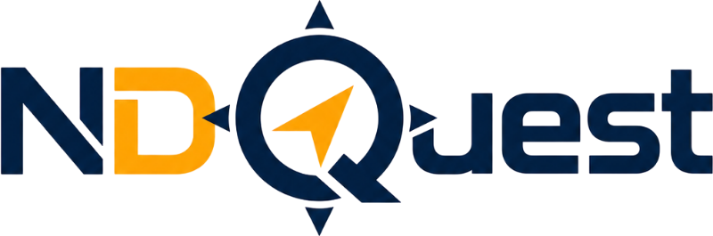
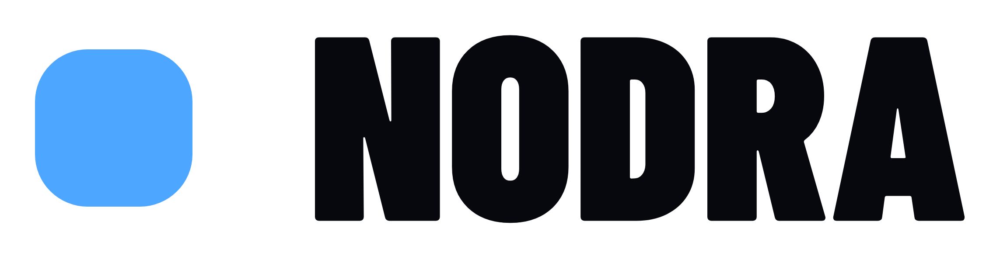
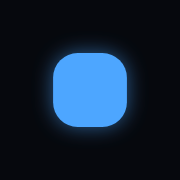
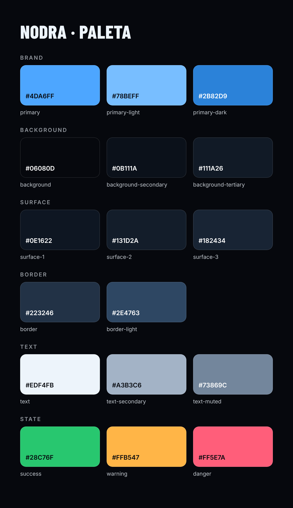
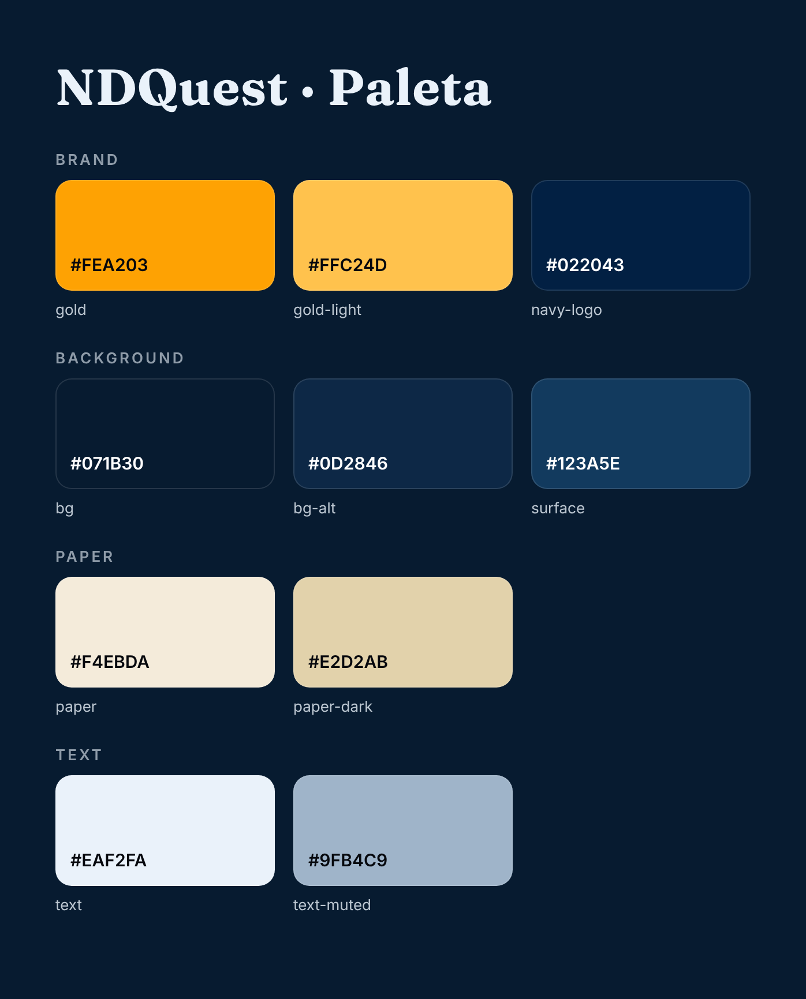
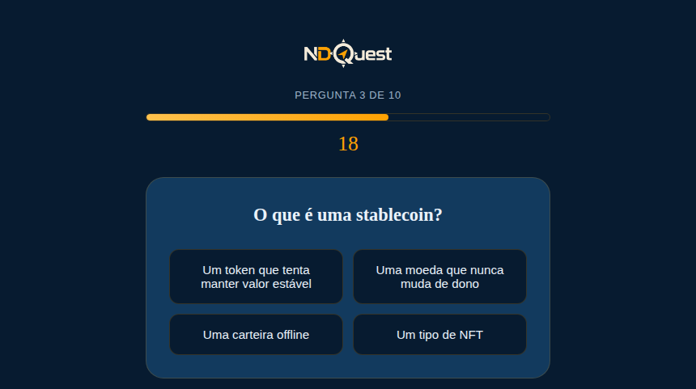
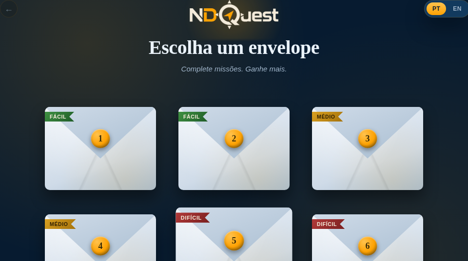
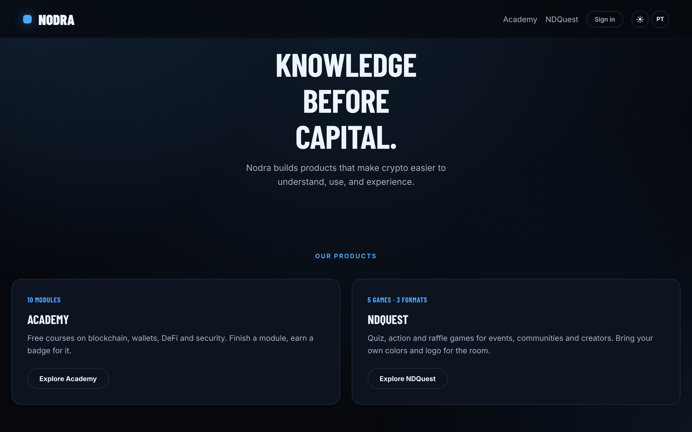

# Nodra · Mídia Kit

Logos, cores, fontes, textos e imagens oficiais da **Nodra** e do **NDQuest**, num lugar só.
Use este repositório sempre que precisar da marca: apresentação, post, evento, material pra
patrocinador ou imprensa.

> **Knowledge before capital.** · **Conhecimento antes do capital.**

<p>
  
  &nbsp;&nbsp;&nbsp;
  
</p>

## O que tem aqui

```
nodra/
  logo/svg/        logo Nodra em vetor (use sempre que puder)
  logo/png/        logo Nodra em PNG com fundo transparente
  icon/            só o símbolo, e o ícone de app (avatar, favicon)
  colors/          paleta em imagem, CSS e JSON
ndquest/
  logo/            logo NDQuest (fundo claro e fundo escuro)
  colors/          paleta do NDQuest
  screenshots/     telas de cada jogo
screenshots/       site nodrahq.com no desktop e no celular
copy/textos.md     slogans e descrições prontos pra copiar (PT e EN)
fonts/             licença das fontes
```

**Precisa só do logo?** Baixe `nodra/logo/svg/nodra-logo-dark-bg.svg` (fundo escuro) ou
`nodra-logo-light-bg.svg` (fundo claro). No GitHub: abra o arquivo e clique em *Download raw file*.

---

## Nodra

### Logo

O logo é o **símbolo** (quadrado azul de cantos arredondados) seguido da palavra **NODRA** em
Barlow Condensed Black, maiúsculas. O texto já está em vetor (contornos), então o SVG funciona
em qualquer programa, mesmo sem a fonte instalada.

| Arquivo | Quando usar |
|---|---|
| `nodra-logo-dark-bg` | **Versão principal.** Fundo escuro, com o brilho azul do símbolo, igual ao site. |
| `nodra-logo-light-bg` | Fundo claro ou branco. Sem brilho. |
| `nodra-logo-white` | Uma cor só, sobre foto ou fundo colorido (inclusive o azul da marca). |
| `nodra-logo-black` | Uma cor só, impressão em preto, carimbo, gravação. |

**Regras de uso**
- **Respiro:** deixe em volta do logo um espaço livre de pelo menos a altura do símbolo.
- **Tamanho mínimo:** 24 px de altura na tela, 8 mm impresso. Abaixo disso, use só o símbolo.
- **Não faça:** esticar ou achatar, trocar a cor do símbolo, mudar a fonte do texto, aplicar
  sombra ou contorno, girar, ou colocar o logo escuro sobre fundo escuro.

<p>
  
</p>

### Símbolo e ícone de app

- `nodra/icon/nodra-icon.svg`: só o símbolo, fundo transparente.
- `nodra/icon/nodra-app-icon.svg` (e PNG em 1024, 512, 180 e 32 px): símbolo com brilho sobre o fundo
  escuro da marca. Use em foto de perfil de rede social, avatar, favicon e ícone de app.



### Cores



A marca é **escura com um azul vivo**. O azul `#4DA6FF` é a cor de destaque: botões, links e
o símbolo. O resto da interface vive nos fundos e superfícies escuras.

| | Hex | Uso |
|---|---|---|
| Primary | `#4DA6FF` | Cor da marca, destaques, símbolo |
| Background | `#06080D` | Fundo principal |
| Surface | `#0E1622` | Cards e áreas elevadas |
| Text | `#EDF4FB` | Texto principal |
| Text secondary | `#A3B3C6` | Texto de apoio |

A paleta completa (estados, bordas, variações) está em `nodra/colors/`: `nodra-colors.css` pra
colar em código e `nodra-colors.json` pra ferramentas de design.

### Tipografia

| | Fonte | Uso |
|---|---|---|
| Títulos | **Barlow Condensed** (600 a 900, maiúsculas) | Logo, títulos, chamadas, números |
| Texto | **Inter** (300 a 700) | Parágrafos, botões, interface |

As duas são gratuitas (licença SIL Open Font License) e estão no Google Fonts:
[Barlow Condensed](https://fonts.google.com/specimen/Barlow+Condensed) ·
[Inter](https://fonts.google.com/specimen/Inter).

---

## NDQuest

Plataforma de jogos da Nodra para eventos, comunidades e creators. Tem identidade própria,
mais quente: azul-marinho com dourado.

| Arquivo | Quando usar |
|---|---|
| `ndquest/logo/ndquest-light-bg.png` | Fundo claro (texto azul-marinho) |
| `ndquest/logo/ndquest-dark-bg.png` | Fundo escuro (texto creme) |



| | Hex | Uso |
|---|---|---|
| Gold | `#FEA203` | Cor da marca, destaques, o "D" e a seta do logo |
| Navy | `#071B30` | Fundo principal |
| Paper | `#F4EBDA` | Creme do logo em fundo escuro, envelopes |
| Text | `#EAF2FA` | Texto principal |

**Fontes:** [Fraunces](https://fonts.google.com/specimen/Fraunces) nos títulos e
[Work Sans](https://fonts.google.com/specimen/Work+Sans) no texto, ambas gratuitas.

**Telas dos jogos** em `ndquest/screenshots/`:

<p>
  
  
</p>

> O logo do NDQuest só existe em PNG (800 px). Se alguém tiver o arquivo original em vetor
> (AI, SVG ou Figma), vale adicionar em `ndquest/logo/`.

---

## Screenshots do site

Telas de [nodrahq.com](https://nodrahq.com) em `screenshots/desktop/` (1440 px, alta resolução)
e `screenshots/mobile/` (iPhone): home, academy, ndquest e about.



## Textos oficiais

Slogan e descrições da Nodra, da Academy, do NDQuest e de cada jogo, em português e inglês:
[`copy/textos.md`](copy/textos.md).

---

## Mantendo o kit atualizado

O kit segue o site. Quando algo mudar na plataforma (cor, fonte, logo, produto novo), atualize
aqui também:
- **Cores e fontes** vêm de `assets/css/variables.css` (Nodra) e
  `ndquest/assets/css/variables.css` (NDQuest) no repositório
  [NodraHQ/Nodra](https://github.com/NodraHQ/Nodra).
- **Textos** vêm das traduções do site (`translations/` e `ndquest/translations/`).
- **Logo da Nodra**: gerado a partir das medidas do CSS do site (`.logo`, `.logo-icon` e
  `.logo-text` em `assets/css/components.css`).

Logos de patrocinadores e parceiros usados nos temas do NDQuest **não** ficam aqui: pertencem
a cada marca.

Última atualização: novembro de 2026.
